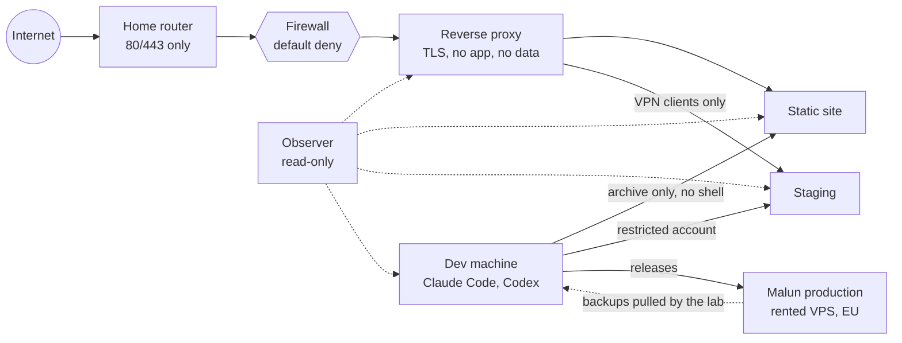

# ATL-Lab

My home lab, run like a small company's infrastructure: segmented networks,
one way in from the Internet, controlled releases, read-only monitoring, and
AI agents that work within strict limits.

It is not a sandbox I rebuild every month. It hosts services that are actually
used: my [personal site](https://antoineleflon.com), a private staging platform,
and the development machine where Claude Code and Codex work. Malun, my
Mandarin learning app, is prepared and tested here, then runs in production
on a rented VPS in the EU (see [Architecture](docs/architecture.md)).

This repository documents how it is built and why. Addresses, VLAN IDs, rule
IDs and anything else that would help an attacker map the network are left
out on purpose.

## Contents

| Document | What it covers |
| --- | --- |
| [Architecture](docs/architecture.md) | Network zones, the path of a request, environments, how a release ships |
| [Security model](docs/security-model.md) | The six rules, how every access is scoped, what agents can never touch |
| [AI agents](docs/ai-agents.md) | Who does what between Claude Code, Codex, Observer and me, and the shared memory |
| [Decisions](docs/decisions.md) | Technical choices and the trade-offs behind them |

## Code

- [atl-preview-controller](https://github.com/Antoine-DOT/atl-preview-controller):
  the private staging platform. Each project gets an isolated Docker Compose
  deployment behind a stable URL. A release is only served once it is healthy,
  and deployment goes through a forced-command SSH account with no shell.
- [second-brain](https://github.com/Antoine-DOT/second-brain): the structure
  of the Obsidian vault that serves as memory for me and the agents.
- [antoineleflon.com](https://github.com/Antoine-DOT/antoineleflon.com): the
  site, with its restricted deployment scripts.

## Stack

Proxmox VE · Debian · nftables · WireGuard · BIND · Nginx · Let's Encrypt ·
Keycloak (OIDC) · Docker Compose · PostgreSQL · Prometheus · Grafana ·
Claude Code · Codex
